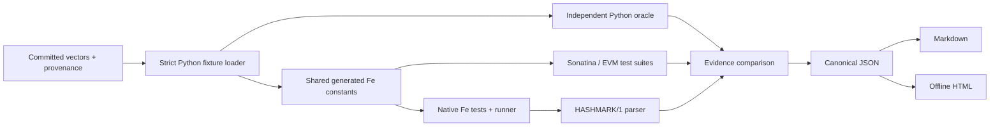

# `##✓` Hashmark

> Reproducible cryptographic evidence for Fe.

Hashmark independently checks Fe 26.6.0's built-in SHA-256 and Ethereum Keccak-256 implementations across native and EVM targets, then turns each vector into inspectable JSON, Markdown, and offline HTML evidence.

**Status:** Fe 26.6.0 · SHA-256 + Ethereum Keccak-256 · native + local EVM tests · Python 3.15.2 oracle · MIT

> Screenshot note: real all-backend screenshots will be added only after the first approved x86-64 CI run. The current ARM64 development host verifies the EVM suite locally and the native runner under user-space QEMU, but cannot honestly capture one integrated all-backend pass without system binfmt support. See [Human actions](docs/HUMAN_ACTIONS.md).

## Why Hashmark exists

A plausible digest is not evidence of correctness. Padding bugs, byte-order mistakes, finalisation errors, and streaming defects often appear only at exact block or rate boundaries. A single `abc` assertion cannot show whether the same implementation behaves correctly for empty input, multi-block messages, split updates, or another compiler target.

Hashmark provides a Fe-first conformance workflow:

- thin adapters over `core::hash`; no cryptographic primitive is reimplemented;
- 32 committed vectors covering known answers, boundaries, and 1 KiB/64 KiB messages;
- ten shared Fe suites on Sonatina/EVM and native backends;
- independent `hashlib.sha256` and PyCryptodome Keccak-256 oracles;
- a strict `HASHMARK/1` native result protocol;
- deterministic JSON, Markdown, and self-contained HTML evidence;
- fail-closed fixture, protocol, subprocess, and report validation.

Hashmark is informal conformance testing. It is not NIST CAVP validation, a security audit, certification, or exhaustive proof.

## Ten-second run

On x86-64 Linux with Fe 26.6.0 and Python 3.15.2 installed:

```console
python3.15 -m venv .venv
source .venv/bin/activate
python -m pip install -r requirements.txt -e .
python -m hashmark run --all --backend all --format all --output-dir reports/local
```

The report opens offline at `reports/local/index.html`. Hashmark refuses to overwrite a non-empty output directory unless `--force` is supplied, and even then it replaces only known Hashmark report files.

## Evidence at a glance

The committed corpus contains 32 vectors: 19 SHA-256 and 13 Ethereum Keccak-256. A complete two-backend run produces 64 backend/vector evidence records, two target-suite outcomes, and 32 native Fe-versus-oracle digest comparisons.

Verified on the current development host:

| Check | Result | Evidence |
| --- | ---: | --- |
| Fe Sonatina/EVM suites | 10/10 pass | `fe test --backend sonatina` |
| Native runner records under QEMU | 32/32 pass | strict `HASHMARK/1` records and summary |
| Python tests | 105 pass | `python -m unittest discover -s tests -v` |
| Python line coverage | 92% | `coverage report`; `hashmark/__main__.py` excluded |
| Deterministic reports | byte-identical | JSON, Markdown, HTML, and sidecar compared across two runs |

The x86-64 GitHub Actions job is the authoritative integrated native run because Fe 26.6.0 does not execute native tests on ARM64 Linux. A skipped or unavailable target is never counted as passing.

## Architecture



The Python layer orchestrates and reports; it does not replace Fe as the implementation under test. The same Fe adapter and vector constants feed both compiler backends. EVM evidence records aggregate suite status because the Fe EVM runner does not expose per-vector return digests. Native evidence carries each actual Fe digest.

Read [Architecture](docs/ARCHITECTURE.md) and [ADR 0001](docs/adr/0001-language-and-architecture.md) for the complete rationale.

## Fe-specific contribution

Hashmark exercises `core::hash::{sha256, Sha256, keccak256, Keccak256}` directly. One-shot calls, repeated state creation, zero-length updates, uneven partitions, fixed chunk sizes, and every two-part split through 140 bytes are tested in Fe. `fe test --backend sonatina` and `fe test --backend native` compile the same source rather than maintaining target-specific vector suites.

Fe calls its local EVM execution backend `sonatina`; Hashmark presents it as `evm` in its public CLI and reports. No contract, wallet, RPC endpoint, testnet, or mainnet deployment is involved.

## SHA-256, Keccak-256, and SHA3-256

Hashmark supports:

- SHA-256 as specified by NIST;
- Ethereum Keccak-256 with Keccak's legacy domain suffix;
- not FIPS SHA3-256.

PyCryptodome's `Crypto.Hash.keccak.new(digest_bits=256)` is the independent Keccak oracle. A regression test proves that Keccak-256(`abc`) differs from `hashlib.sha3_256(b"abc")`.

## Verification method

1. Validate every fixture before invoking Fe.
2. Compute the oracle digest from the fixture bytes, never from Fe output.
3. Run the requested Fe backend.
4. Parse native records with exact field, identifier, digest, uniqueness, and summary checks.
5. Compare fixture, Fe, and oracle values.
6. Validate the report invariants before writing it atomically.
7. Write stable, sorted artefacts without timestamps, host paths, randomness, or elapsed time.

SHA-256 canonical vectors are traced to NIST CAVP material. Keccak vectors were reproduced against XKCP commit `d20c8fcaecc543f816a0721d0dfc13b4cf27c14d`. Deterministic boundary inputs use `byte[i] = (i * 131 + 17) mod 256`. See [Cryptography and provenance](docs/CRYPTOGRAPHY.md) and [Vector format](docs/VECTOR_FORMAT.md).

## CLI reference

```console
python -m hashmark --help
python -m hashmark version
python -m hashmark list [--algorithm sha256|keccak256]
python -m hashmark validate-vectors
python -m hashmark run --all [--backend native|evm|all]
python -m hashmark run --algorithm sha256
python -m hashmark run --vector sha256-abc
python -m hashmark run --all --format all --output-dir reports/local
```

`--format` accepts `terminal`, `json`, `markdown`, `html`, or `all`. `--timeout-seconds` accepts 1–600. `HASHMARK_FE_BIN`, `HASHMARK_TIMEOUT_SECONDS`, `HASHMARK_OUTPUT_DIR`, and `NO_COLOR` are optional; no secrets or `.env` file are required.

| Exit | Meaning |
| ---: | --- |
| 0 | every requested check completed and passed |
| 1 | conformance mismatch or Fe assertion failure |
| 2 | invalid argument or fixture |
| 3 | missing or wrong toolchain/dependency |
| 4 | timeout, process failure, or invalid native protocol |
| 5 | report validation or write failure |

## Add a vector

1. Add the fixture to the correct JSON document under `vectors/sha256/` or `vectors/keccak256/`.
2. Include the authoritative HTTPS source, document, case ID, and usage note.
3. Run `python -m hashmark validate-vectors`.
4. Regenerate Fe constants with `python scripts/generate_fe_vectors.py`.
5. Run the exact vector, then the full Python and Fe suites.

Never edit an expected digest merely to make a failing suite green. Check the source vector and independent oracle first. See [Contributing](CONTRIBUTING.md).

## Toolchain and platform support

The project requires exact versions:

- Fe `26.6.0 (5b3f96a)`;
- Python `3.15.2`;
- PyCryptodome `4.4.0`.

Install Fe with the official versioned installer:

```console
curl -fsSL https://raw.githubusercontent.com/argotorg/fe/v26.6.0/feup/feup.sh -o /tmp/feup.sh
echo "b2dffd2d9d5b1a07d18e9321f57ab08442cc50df4a6004ee2fb538963812ee78  /tmp/feup.sh" | sha256sum --check --strict
bash /tmp/feup.sh --version v26.6.0 --no-modify-path
export PATH="$HOME/.fe/bin:$PATH"
```

| Host | EVM | Native |
| --- | --- | --- |
| x86-64 Linux | supported | supported |
| AArch64 macOS | supported | supported by Fe 26.6.0 |
| AArch64 Linux | supported | use the x86-64 CI job |
| Windows | use WSL2 | use WSL2 on x86-64 |

## Tests and CI

```console
fe fmt --check
fe check
fe test --backend sonatina
fe test --backend native
python -m pip install -r requirements-dev.txt -e .
python -m coverage run -m unittest discover -s tests -v
python -m coverage report
python -m hashmark validate-vectors
```

The pinned GitHub Actions workflow runs separate Fe, Python, integration, and dependency-consistency jobs. Integration generates the full report twice, compares every artefact byte-for-byte, validates report invariants, and uploads the evidence directory.

## Limitations and non-claims

- Passing Hashmark does not provide formal NIST CAVP validation or certification.
- Hashmark is not a security audit, proof of cryptographic security, or exhaustive input test.
- Fe 26.6.0 describes itself as not production-ready; this project records observed behavior for that pinned compiler.
- EVM records carry aggregate Fe test evidence rather than fabricated per-vector EVM digests.
- The standard corpus is deterministic and bounded; fuzzing and benchmarking are outside the MVP.

## Contest and AI-assistance disclosure

Hashmark was built for the [Fe Builders Challenge](https://fe-lang.org/contest/) during the official build window. An autonomous OpenAI coding agent assisted with research, implementation, tests, documentation, and reproducibility work under the project owner's direction. The responsible human entrant must review, understand, and be able to explain the code, architecture, evidence model, and limitations.

Hashmark reuses no cryptographic implementation. It calls Fe `core::hash`, Python `hashlib`, and PyCryptodome, and attributes NIST and XKCP vector sources. Research references and exact source decisions are recorded in [Implementation notes](docs/IMPLEMENTATION_NOTES.md).

## Licence

Hashmark source is available under the [MIT licence](LICENSE). Third-party names, links, and vector provenance remain attributable to their respective projects and do not imply endorsement.
