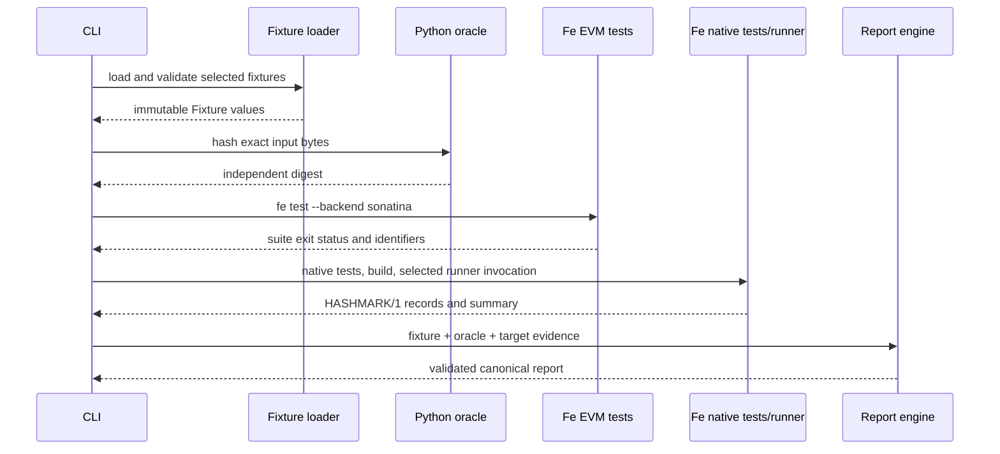

# Architecture

## Purpose

Hashmark establishes reproducible evidence about Fe's existing hash implementations. It deliberately separates the implementation under test, independent references, orchestration, and presentation so that no one layer can silently manufacture a pass.

## Components

| Component | Responsibility | Trust boundary |
| --- | --- | --- |
| `src/sha256.fe`, `src/keccak256.fe` | thin adapters over `core::hash` | Fe compiler and core library |
| `src/tests.fe` | shared target-neutral assertions and streaming checks | Sonatina and native execution backends |
| `src/native_runner.fe` | deterministic per-vector digest emission | untrusted stdout at the Python boundary |
| `vectors/` | immutable input, expected digest, and provenance | strict schema before execution |
| `hashmark/oracle.py` | independent Python digest calculation | Python standard library and PyCryptodome |
| `hashmark/protocol.py` | fail-closed `HASHMARK/1` parsing | native process output |
| `hashmark/workflow.py` | target execution and evidence assembly | subprocess and filesystem boundaries |
| `hashmark/report.py` | canonical report construction and atomic output | report schema and output directory |
| `hashmark/renderers.py` | deterministic Markdown and offline HTML | escaped fixture metadata |

## Data flow

## Evidence semantics

Native records contain the actual digest emitted by Fe, so native results compare fixture, Fe, and oracle values byte-for-byte. The current EVM test runner exposes aggregate test output rather than per-vector digest returns. EVM result rows therefore use `evidence_basis: evm_test_status` and set `fe_digest` to `null`; they never fabricate a value.

An overall report is `PASS` only when every selected result is `PASS` and every requested target completed with `PASS`. `SKIPPED`, `UNAVAILABLE`, `NOT_RUN`, and empty result sets cannot produce success.

## Determinism

Reports use stable ordering by algorithm, vector ID, and backend. They contain no generated time, duration, host path, random identifier, or network-fetched data. Source and fixture content receive separate SHA-256 fingerprints. JSON uses UTF-8, LF line endings, sorted keys, and a trailing newline. The JSON sidecar hashes the finished report to avoid self-reference.

## Security boundaries

- Fixture IDs cannot contain path separators or traversal segments.
- Fixture count, individual input size, metadata length, stdout, stderr, and process duration are bounded.
- Subprocesses use argument arrays and never `shell=True`.
- Native stdout accepts only the fixed protocol; diagnostics remain on stderr.
- HTML fixture content is escaped, and source links require HTTPS.
- Output replacement is restricted to known Hashmark filenames.
- Runtime code has no network listener, telemetry, credential, wallet, or RPC integration.

## Platform decision

Fe 26.6.0 supports native executable/test emission on x86-64 Linux and AArch64 macOS. The development node is AArch64 Linux, so local native execution is reported unavailable by the public CLI. User-space QEMU verified the emitted x86-64 native runner, but nested native test execution still requires binfmt. The pinned x86-64 GitHub Actions job is therefore authoritative for the integrated native suite.

See [ADR 0001](adr/0001-language-and-architecture.md) and [Implementation notes](IMPLEMENTATION_NOTES.md).
